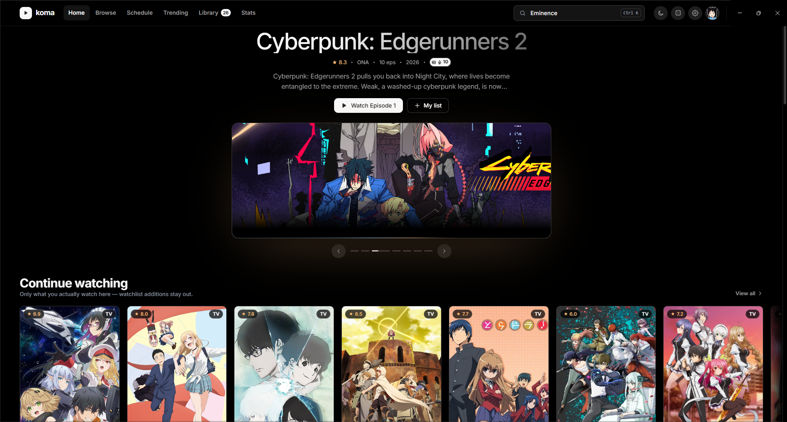
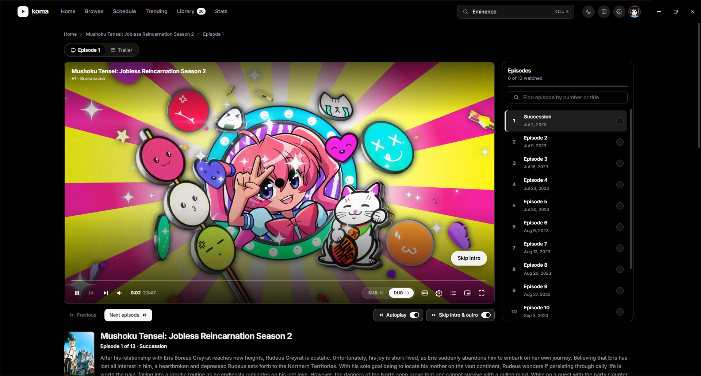
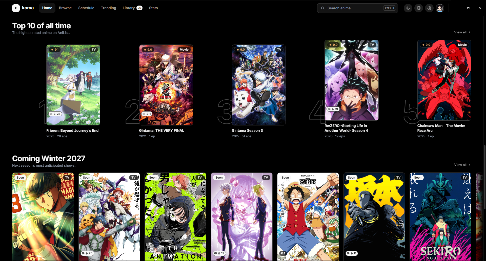

# Koma Stream

A dark, modern anime streaming app for Windows — a full catalog with tracking on one side, a custom-built video player with sub/dub on the other, and the streaming servers it needs **bundled inside the app itself**. One installer, no system dependencies, no console windows. Ever open the app and everything is just running.

| Home | |
| --- | --- |
|  |  |

| Top 10 & coming soon | |
| --- | --- |
|  | |

## What you get

**Catalog & tracking**
- Live data from AniList: trending, seasonal, all-time top 10, genres, search with instant suggestions
- Weekly airing schedule with countdowns, in your timezone
- Personal list, watch progress, resume points, "continue watching" — saved locally, synced with your AniList account if you sign in
- Sub/dub episode counts on every poster, so you know before you click

**The player**
- Custom-built on hls.js — plays **Japanese sub and English dub** where available, with a one-click toggle that remembers your preference
- Auto-skip intro/outro when the source provides timestamps, autoplay next episode with a cancelable countdown, resume where you left off
- Quality, speed, and subtitle menus; picture-in-picture; fullscreen; full keyboard shortcuts (space/K, J/L, arrows, F, M, N, C)
- A next-episode transition lock, so autoplay can never skip or double-advance episodes

**The app**
- Everything runs locally: the site, the streaming API, and the catalog server are all bundled — Electron's own Node runs the site and the streaming API, and a portable Python runs the catalog server
- All servers bind to 127.0.0.1 only — nothing is exposed to your network, no firewall prompts
- One `.exe` installer (~132 MB download, ~475 MB installed): per-user install, no admin prompt, desktop + Start menu shortcuts, clean uninstaller

## Install

1. Download **`Koma-Setup.exe`** from the [latest release](../../releases/latest)
2. Run it — that's the whole process
3. Koma opens, boots its servers in the background, and drops you into the site

Requires Windows 10/11 x64. Nothing else — no Node, no Python, no npm.

Logs, if you ever need them, live in `%APPDATA%\Koma\logs`.

## Build from source

```
git clone https://github.com/Braedennn/Koma-Stream.git
cd Koma-Stream\desktop
build-app.bat
```

Requirements for building: Node.js 20+ (first run also downloads a portable Python and compiles the streaming server automatically). The finished app lands in `desktop\dist\Koma-win32-x64`.

To produce the installer instead, install [NSIS](https://nsis.sourceforge.io) once and run `desktop\build-installer.bat` — it packs the app into `desktop\dist\Koma-Setup.exe`.

## How it works

```
Koma.exe (Electron)
├─ app-site\        the Koma site — Node server + frontend, run by Electron's own Node
├─ anivault\        compiled streaming API (TypeScript → JS) with production deps
└─ allanime\        catalog/sub-dub-counts server + its own portable Python
```

The window is the site's own UI with a frameless title bar. Clicking play resolves the episode through the local streaming API, which proxies the video so playback, subtitles, and seeking all work same-origin. Close the app and the servers it started stop with it.

## Repo layout

| Path | What it is |
| --- | --- |
| `desktop/` | Electron app: `main.js` (server orchestration), `build.mjs` (one-command bundler), installer script |
| `server.js`, `server/`, `public/` | The Koma site — zero-dependency Node server, API, and frontend |
| `Servers - DONT TOUCH/anivault-scraper` | Vendored streaming API with local patches (below) |
| `Servers - DONT TOUCH/allanime-api` | Vendored catalog API (FastAPI) with a null-safety fix |
| `screenshots/` | The previews above |

**Vendored AniVault patches** (kept on top of upstream, re-apply if you pull a fresh copy): dotenv loading, `ALLOWED_ORIGINS=*` support for local use, a browser-proxy regex fix, and `proxiedVideoUrl` gaining the referer parameter its callers already passed.

## Notes

- The `ANIVAULT_API_KEY` in the repo only gates the local API on your own machine (it's bound to 127.0.0.1) — every install ships one; it's not a secret.
- The API key requirement can be disabled entirely by leaving it empty in the env file.
- Catalog data comes from [AniList](https://anilist.co); playback is resolved by local streaming servers and proxied through your machine.

## Credits

- [AniList](https://anilist.co) — catalog, metadata, schedules, tracking
- [AniVault-Scraper](https://github.com/SH0MIK/Anivault-Scraper) — streaming API (vendored, patched)
- [AllManga.to-API](https://github.com/walterwhite-69/AllManga.to-API) — catalog API (vendored)
- [hls.js](https://github.com/video-dev/hls.js) — HLS playback
- Site typography: Sora & Inter via Google Fonts

## License

[MIT](LICENSE) — site, app shell, and build tooling. Vendored servers keep their upstream licenses.
