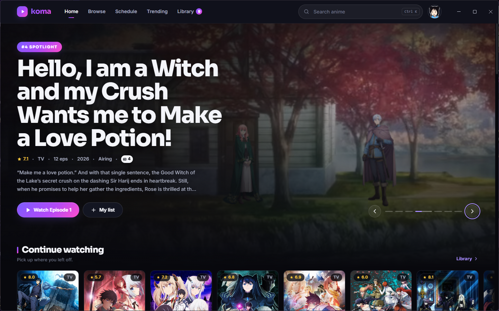
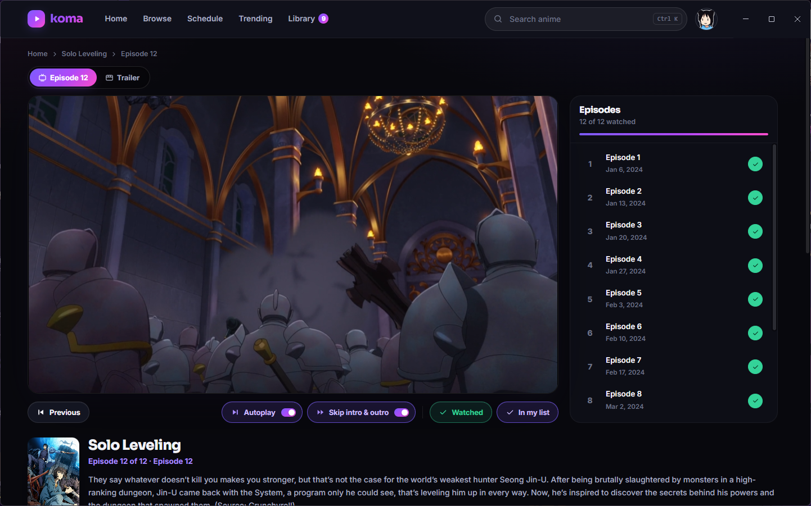
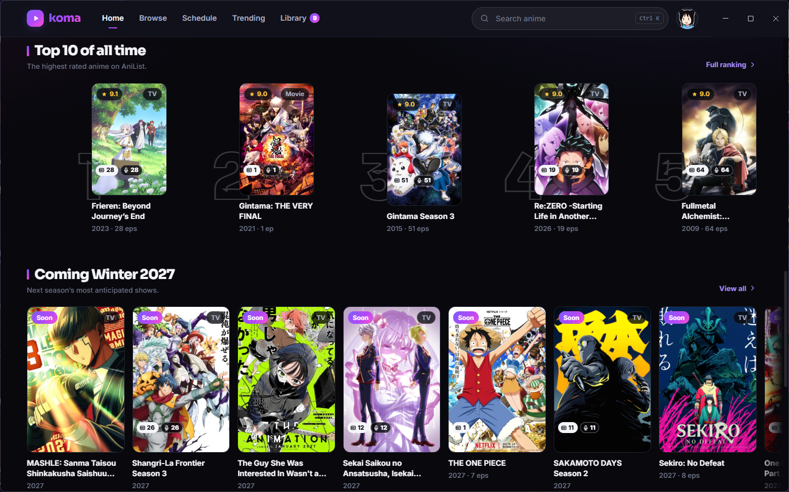

# Koma Stream

A dark, modern anime streaming app for Windows — a full catalog with tracking on one side, a custom-built video player with sub/dub on the other, and the streaming servers it needs **bundled inside the app itself**. One installer, no system dependencies, no console windows. Open the app and everything is just running.

| Home | Watching |
| --- | --- |
|  |  |

| Top 10 & coming soon |
| --- |
|  |

## What you get

**Catalog & tracking**
- Live data from AniList: trending, seasonal, all-time top 10, genres, search with instant suggestions
- Weekly airing schedule with countdowns, in your timezone
- Personal list, watch progress, resume points, "continue watching" — saved locally, synced with your AniList account if you sign in
- Sub/dub episode counts on every poster, so you know before you click
- **Desktop notifications** when a show in your list drops a new episode — a Windows toast that opens straight into it

**The player**
- Custom-built on hls.js — plays **Japanese sub and English dub** where available, with a one-click toggle that remembers your preference
- Auto-skip intro/outro when the source provides timestamps, autoplay next episode with a cancelable countdown, resume where you left off
- Quality, speed, and subtitle menus; picture-in-picture; fullscreen; full keyboard shortcuts (space/K, J/L, arrows, F, M, N, C)

**The app**
- Everything runs locally and is bundled inside the app — no Node, no Python, no npm needed on your machine
- **Discord Rich Presence** — the show and episode you're watching live on your Discord profile, with your current page when you're browsing (one-time setup in App settings)
- All servers bind to 127.0.0.1 only — nothing is exposed to your network, no firewall prompts
- Close the app and the servers it started stop with it
- Logs, if you ever need them, live in `%APPDATA%\Koma\logs`

## Install

1. Download **`Koma-Setup.exe`** from the [latest release](../../releases/latest)
2. Run it — per-user install, no admin prompt, desktop + Start menu shortcuts, clean uninstaller
3. Koma opens, boots its servers in the background, and drops you into the site

Requires Windows 10/11 x64. Installed size ~475 MB.

## Notes

- Catalog data comes from [AniList](https://anilist.co); playback is resolved by the app's own local streaming servers and proxied through your machine.

## Credits

- [AniList](https://anilist.co) — catalog, metadata, schedules, tracking
- [hls.js](https://github.com/video-dev/hls.js) — HLS playback
- Site typography: Sora & Inter via Google Fonts

## License

[MIT](LICENSE)
